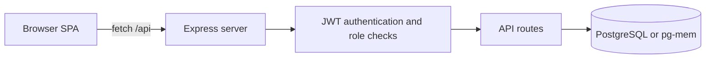

# EnterpriseOS

An operations workspace for workforce visibility, delivery tracking, and role-based collaboration.

## Overview

EnterpriseOS is a Node.js modular-monolith application for managing employees, departments, attendance, leave, projects, tasks, performance reviews, notifications, reports, and audit activity in an organization-scoped workspace.

## Problem Statement

Workforce information and delivery work often live in disconnected tools. Teams need a single, access-controlled view of people operations and project execution.

## Solution

The application serves a browser-based workspace and JSON API from one Express process. JWT identity establishes an organization and role for each request; database queries apply the resulting scope.

## Core Features

- JWT sign-in with Admin, Manager, and Employee roles
- People and department administration
- Clock-in/out, attendance records, and CSV export
- Leave requests and elevated-role approval workflow
- Projects, task assignment, execution board, and task-status workflow
- Role-scoped project and task visibility
- Performance reviews, notifications, dashboard metrics, and audit logs

## Technology Stack

- Node.js (ES modules) and Express
- Browser-native HTML, CSS, and JavaScript
- PostgreSQL through `pg`; `pg-mem` is available only for local development and tests
- `bcryptjs` for passwords and `jsonwebtoken` for bearer tokens
- Docker and Docker Compose
- Node built-in test runner

## System Architecture



See [architecture documentation](docs/architecture.md).

## Authentication & Authorization

`POST /api/auth/login` returns an eight-hour JWT. Authenticated calls use `Authorization: Bearer <token>`. Server routes perform role checks and organization scoping. Admins can see organization-wide delivery data, managers see their managed projects, and employees see their assigned tasks/projects.

## Multi-Tenancy

Implemented: tenant-owned tables use `organization_id`, and authenticated API queries scope access to the token's organization.

## Database & API

See [database documentation](docs/database.md) and [API documentation](docs/api.md).

## Local Development

```bash
cp .env.example .env
npm ci
npm run dev
```

Without `DATABASE_URL`, the app uses an in-memory database that resets on restart. For persistent data:

```bash
docker compose up -d postgres
npm run dev
```

With an empty `DATABASE_URL`, `npm run dev` initializes an in-memory schema and local demo data in the same application process. It is reset whenever the process stops. For PostgreSQL, run `npm run db:migrate` explicitly; migrations and seeds never run at production or Vercel startup.

## Environment Variables

| Variable | Required | Purpose |
| --- | --- | --- |
| `PORT` | No | HTTP port; defaults to `4000` |
| `DATABASE_URL` | Production | Neon/PostgreSQL connection string. Production startup fails when it is absent. |
| `JWT_SECRET` | Yes | Unique signing secret of at least 32 characters. |
| `CORS_ORIGIN` | Production | Comma-separated browser origins allowed to call the API, for example `https://your-app.vercel.app`. |

## Demo Accounts

When using the in-memory local development database, `npm run dev` creates `admin@demo.com`, `manager@demo.com`, and `employee@demo.com`. The development password is `Demo@12345`. For a persistent local PostgreSQL database, run `npm run db:seed-demo`; that command refuses to run in production.

## New employee onboarding

Creating an employee produces a unique, one-time initial password visible only in the administrator's create-employee response. Share it through a secure channel. The employee can only change that password after their first sign-in; application access is blocked until the change succeeds.

## Testing

```bash
npm test
npm audit
```

See [testing documentation](docs/testing.md).

## Docker

```bash
docker compose up --build
```

See [deployment documentation](docs/deployment.md) for Vercel and Neon setup, migrations, required variables, and a post-deployment smoke test.

## Project Structure

```text
public/   Browser application assets
server/   Express server, auth, database schema, and seed data
test/     Node test files
docs/     Engineering documentation
```

## Screenshots

Screenshot to be added.

## Team Contributions

- Developer 1 — Backend/API/database: routes, authorization, schema, and seed data
- Developer 2 — Frontend/UI: browser UI, task board, forms, and accessibility
- Developer 3 — Integration/DevOps/quality: Docker, CI, test automation, analytics/reporting, and documentation

## Roadmap

- Expand automated API and browser-level tests
- Add pagination and server-side filtering for large datasets

## Known Limitations

The current test suite is focused on authentication and critical tenant boundaries. Local `pg-mem` behavior may differ from Neon PostgreSQL; run the explicit migration against a non-production Neon branch before production. See [security documentation](docs/security.md).

## License

MIT. See [LICENSE](LICENSE).
