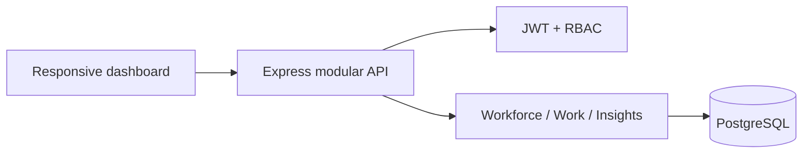

# EnterpriseOS

EnterpriseOS is a modular, multi-tenant workforce management and collaboration platform. It includes authentication, RBAC, employee and department administration, attendance, leave approvals, projects, task workflow/Kanban, performance reviews, notifications, reporting and audit logging.

## Run locally

```bash
cp .env.example .env
npm install
docker compose up -d postgres
npm run dev
```

Open `http://localhost:4000`. The API and SPA are served together. The schema and realistic demo data are applied automatically on first start.

When `DATABASE_URL` is omitted, the app automatically uses an in-memory development database so the UI starts without Docker. Data is reset when the server stops. Set `DATABASE_URL` for persistent PostgreSQL storage.

Demo accounts (development only): `admin@demo.com`, `manager@demo.com`, `employee@demo.com` — password: `Demo@12345`.

## Design

The modular-monolith API derives tenant context and permissions solely from the JWT. Every tenant resource query is scoped by `organization_id`; IDs received from a browser never determine tenant scope. Sensitive mutations are written to `audit_logs`, and actionable events create notifications.



See [docs/architecture.md](docs/architecture.md), [docs/api.md](docs/api.md), and [docs/security.md](docs/security.md).
