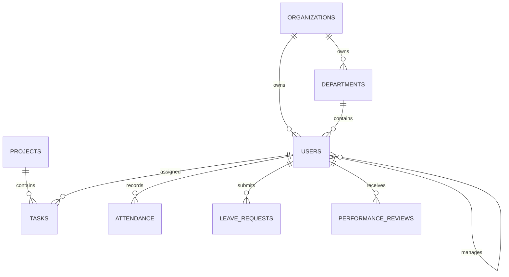

# Database

EnterpriseOS uses PostgreSQL via `pg`. When `DATABASE_URL` is absent, `pg-mem` provides an in-memory development database; it is not persistent.

## Tables

| Table | Purpose / important constraints |
| --- | --- |
| `organizations` | Tenant root; UUID primary key. |
| `departments` | Organization departments; unique organization/name. |
| `users` | Accounts, roles, department, optional direct `manager_id`; unique organization/email. |
| `attendance` | Daily clock in/out; unique user/work date. |
| `leave_requests` | Leave dates, reason, workflow status, reviewer. |
| `projects` | Organization projects with manager, priority, status, and due date. |
| `tasks` | Project work items with assignee, creator, workflow status, and due date. |
| `performance_reviews` | Employee/reviewer ratings, feedback, and goals. |
| `notifications` | Per-user messages and read state. |
| `audit_logs` | Append-only application audit events and JSON metadata. |

Tenant-owned records contain `organization_id`. Key foreign keys include user-to-department/manager, task-to-project/assignee/creator, and attendance/leave/notification/review-to-user. Indexes exist for task tenant/status, user manager, and audit tenant/time queries.

`server/seed.js` adds a development organization with multiple departments, roles, projects, tasks, attendance entries, leave requests, reviews, notifications, and an audit entry.
